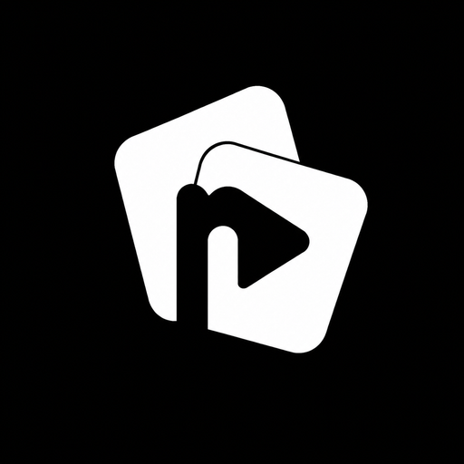
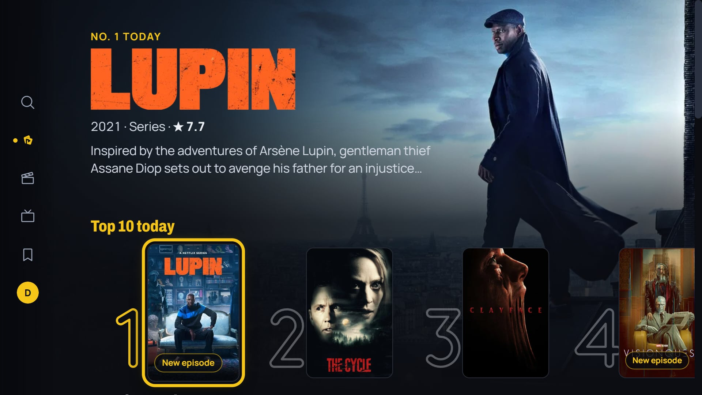
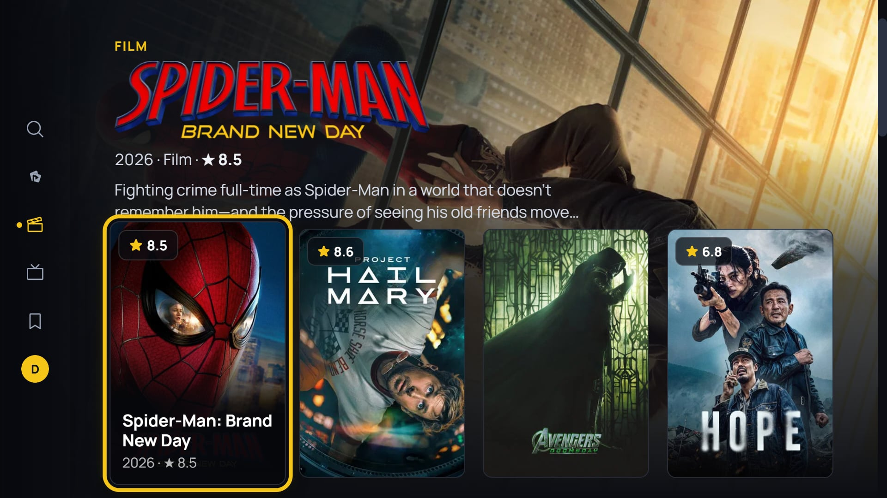
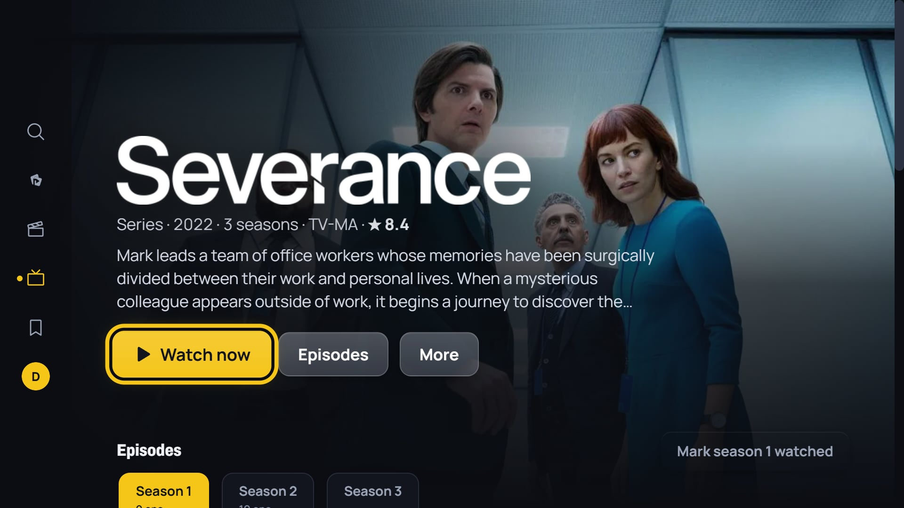
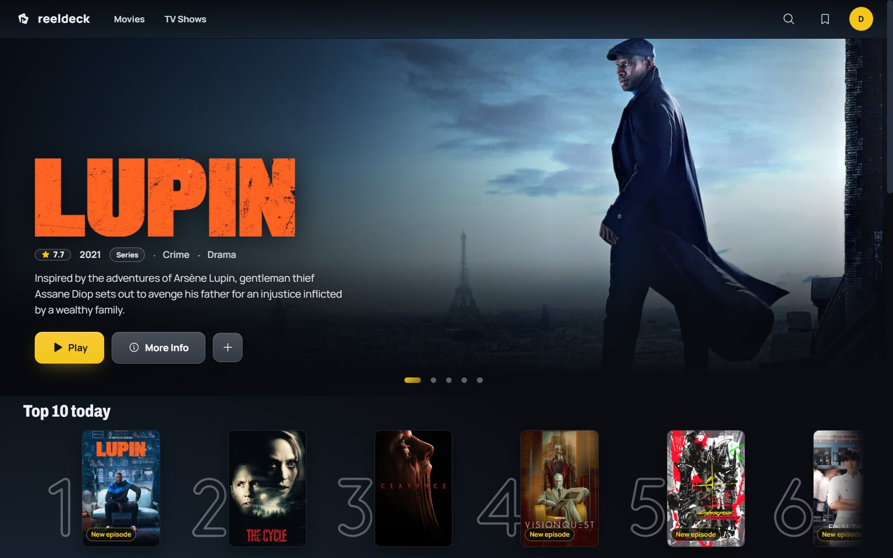
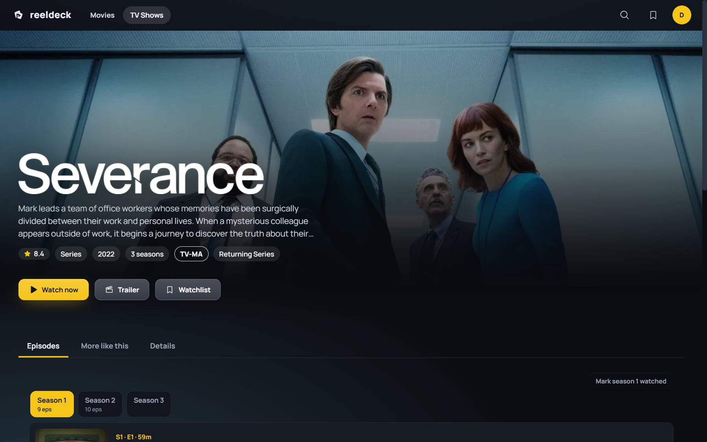
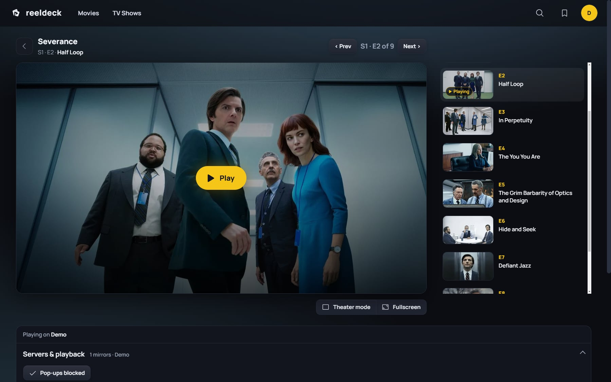
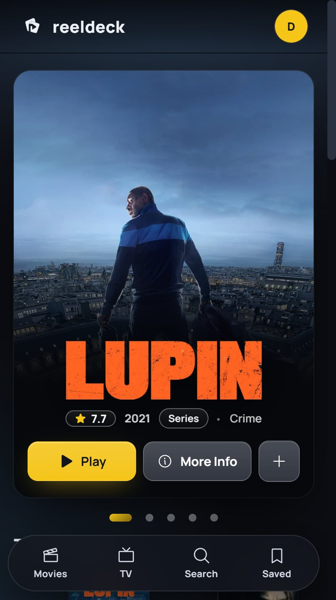
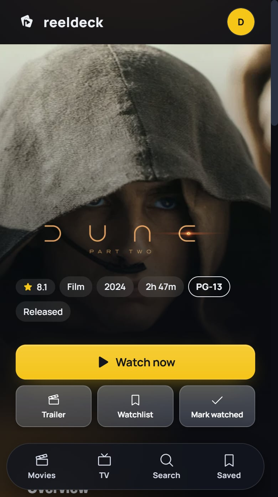

<div align="center">



# Reeldeck

**A cinematic movie and TV browser for your TV, desktop and phone.**<br>
Built on [TMDB](https://www.themoviedb.org), designed for a remote first.

[](https://github.com/jaig-eye/reeldeck/releases/latest)
[](#-get-it)
[](LICENSE)

<br>



</div>

> [!IMPORTANT]
> **Reeldeck ships with no video sources.** It is a front end for TMDB's catalogue: posters, details, cast, seasons, trailers.
> Playback comes from sources **you** add, ones you have the right to use, through your own backend. See [Bring your own backend](#-bring-your-own-backend).

## ✨ Features

- 📺 **Built for the remote.** On a TV the focused title's backdrop, logo and story fill the screen behind its row, the focused row always sits in the same place, and a side rail holds the sections. Hold OK on any title for quick actions.
- ⚡ **Instant title pages.** A title page paints the moment you open it and loads ahead while you browse, without the layout jumping when the rest arrives.
- ▶️ **Nothing loads until you press Play.** The player waits in the page, servers are health-checked so the dead ones step aside, and full screen is your choice.
- 🔄 **Sync with a four-digit code.** Your code is your account: watchlist, history and resume points follow it to every device you enter it on.
- 🔎 **Search and browse.** Filters, genres, keywords, cast and crew filmographies, a Top 10, new episodes, and "because you watched".
- 🎨 **Seven themes**, from OLED black to Daylight.
- 🛡️ **Locked-down players.** The desktop app stops embedded players opening links, windows or downloads; the web build sandboxes them against pop-ups.
- 💻 **One codebase, every screen.** Android TV and Google TV, LG webOS, Windows, macOS, Android phones and any modern browser (installable as an app).

## 📸 Screenshots

<table>
  <tr>
    <td width="50%"><br><sub>📺 Browse on TV: the focused card drives the backdrop</sub></td>
    <td width="50%"><br><sub>📺 A title on TV</sub></td>
  </tr>
  <tr>
    <td><br><sub>💻 Desktop: point at a card and it takes the hero</sub></td>
    <td><br><sub>💻 A title page with Episodes, More like this and Details</sub></td>
  </tr>
  <tr>
    <td colspan="2"><br><sub>▶️ The player beside its episodes, servers underneath</sub></td>
  </tr>
</table>

<p align="center">
  
  &nbsp;&nbsp;
  
</p>

## 📥 Get it

| Platform | How |
| --- | --- |
| 📺 **Android TV / Google TV** | Sideload [`Reeldeck.apk`](https://github.com/jaig-eye/reeldeck/releases/latest/download/Reeldeck.apk) (Downloader, or `adb install`). It updates itself. |
| 🖥️ **Windows** | The installer or the portable `.exe` from the [latest release](https://github.com/jaig-eye/reeldeck/releases/latest). It updates itself. |
| 🍎 **macOS** | The `.dmg` for Apple silicon (`arm64`) or Intel (`x64`) from the [latest release](https://github.com/jaig-eye/reeldeck/releases/latest). |
| 📱 **Android phone** | The same [`Reeldeck.apk`](https://github.com/jaig-eye/reeldeck/releases/latest/download/Reeldeck.apk). |
| 📡 **LG webOS** | Build it with `npm run webos:ipk` and install it in Developer Mode ([below](#lg-webos)). |
| 🌐 **Web** | Any modern browser. Add it to your home screen to use it as an app. |

> [!NOTE]
> The release builds are set up for the backend they were built for, which asks for its own access codes.
> To use Reeldeck yourself, run your own backend and build the apps with its address. It takes about fifteen minutes.

## 🧩 Bring your own backend

Reeldeck's backend is one Cloudflare Worker in front of a free Upstash Redis database. It turns four-digit access codes into accounts, syncs each account's watchlist, history and resume points, and serves **your** list of playback sources, health-checking each one so the app can set aside the ones that are not answering.

The Worker is [`worker/reeldeck-sync.js`](worker/reeldeck-sync.js): one file, no build step, no dependencies.

**1. Make a database.** Create a free Redis database at [Upstash](https://upstash.com) and copy its REST URL and REST token.

**2. Make the Worker.** In the [Cloudflare dashboard](https://dash.cloudflare.com), go to **Workers & Pages → Create → Worker**, open the editor, paste in `worker/reeldeck-sync.js` and **Deploy**.

**3. Add its settings** under **Settings → Variables and Secrets**, as secrets:

| Name | Value |
| --- | --- |
| `UPSTASH_REDIS_REST_URL` | The REST URL from step 1 |
| `UPSTASH_REDIS_REST_TOKEN` | The REST token from step 1 |
| `ACCESS_CODES` | One `name=code` pair per person, four digits each: `alex=1234, sam=5678`. The name is the account. |
| `ACCESS_SIGNING_KEY` | Any 32 or more random characters. It signs the tokens devices keep, for 90 days. |

**4. Add your sources.** Create a KV namespace (**Storage & Databases → KV**), bind it to the Worker as `SOURCES_KV` (**Settings → Bindings**), and add one entry per source. The key is `src:` plus any name; the value is JSON:

```json
{
  "name": "My Service",
  "movie": "https://player.example.com/movie/{id}",
  "tv": "https://player.example.com/tv/{id}/{season}/{episode}",
  "order": 1
}
```

Placeholders: `{id}` (TMDB id), `{imdb}`, `{season}`, `{episode}`, `{color}`. Optional fields: `tracked: 1` if the player reports playback position, `resume` (the URL parameter it takes a start time in) and `order` (lower comes first). The app sees a change within five minutes, with nothing to redeploy. No KV yet? A plain variable `SOURCES_JSON` holding a JSON array of the same objects works too.

> [!WARNING]
> **Only add sources you are licensed to use.** Reeldeck does not host, index or provide any content, and [Cloudflare's terms](https://www.cloudflare.com/terms/) do not allow a Worker to link to material that infringes anyone's rights. What you connect is your responsibility.

**5. (Optional) Keep the health check warm** with a Cron Trigger every 10 minutes (**Settings → Triggers**).

**6. Point the app at it.** Set `SYNC_URL` near the top of [`app.js`](app.js) to your Worker's address (`https://<name>.<you>.workers.dev`), then build the apps (below). While you are there, `apiKey` is the [TMDB API key](https://www.themoviedb.org/settings/api) the app uses; you can use your own.

## 🛠️ Build from source

You need [Node.js](https://nodejs.org) 22 and npm. Reeldeck is plain JavaScript with no framework and no build step, so the web app is just the files in the repository.

```bash
npm install
```

```bash
npm run serve            # the web app on http://127.0.0.1:5178
```

```bash
npm start                # the desktop app (Electron)
```

```bash
npm run dist             # Windows installer and portable .exe
```

```bash
npm run apk              # Android / Android TV debug APK (needs the Android SDK)
```

```bash
npm run webos:ipk        # LG webOS package, into dist-webos/
```

Releases are built in the cloud: pushing a `v*` tag runs [the release workflow](.github/workflows/build.yml), which builds Windows, macOS and Android and publishes them together, and every push to `main` republishes the web app. [`DISTRIBUTION.md`](DISTRIBUTION.md) covers signing, macOS and the details.

### LG webOS

The webOS app is a small launcher ([`webos/`](webos)) that opens the hosted web app in TV mode, so every release reaches the TV with nothing to reinstall. It runs on webOS 6 (2021 sets) and later; [`compat.css`](compat.css) fills in what their older browser engine lacks.

1. On the TV, install **Developer Mode** from the LG Content Store, sign in with a free [LG developer account](https://webostv.developer.lge.com) and switch it on.
2. Build the package with `npm run webos:ipk`.
3. Register the TV once with `npx ares-setup-device`, naming it `tv` (you need its IP address and the passphrase Developer Mode shows), then install:

```bash
npx ares-install dist-webos/com.reeldeck.app_*.ipk -d tv
```

Developer Mode sessions last about 50 hours; extend them in the Developer Mode app.

## 🎮 On a TV remote

| Press | To |
| --- | --- |
| ◀ ▶ ▲ ▼ | Move. Left at the start of a row opens the side rail. |
| **OK** | Open, or play |
| Hold **OK** | Quick actions: watchlist, mark watched, details |
| **Back** | Close, leave full screen, go back. On Home it exits. |

On LG, the Magic Remote's pointer works too: point at a title and it takes the stage.

## 🧱 How it's built

| Piece | What |
| --- | --- |
| [`app.js`](app.js) | The whole app: one vanilla JavaScript file, no framework |
| [`styles.css`](styles.css), [`stage.css`](stage.css) | The look; `stage.css` is the TV-first design system |
| [`compat.css`](compat.css) | Generated fallbacks for older TV browsers (`npm run compat`) |
| [`android/`](android) | The Android and Android TV app (Capacitor) |
| [`electron/`](electron) | The desktop app, including the player lockdown |
| [`webos/`](webos) | The LG webOS launcher |
| [`worker/`](worker) | The backend: a Cloudflare Worker over Upstash Redis |

## 🙏 Credits

Movie and TV metadata and images are from [TMDB](https://www.themoviedb.org). **This product uses the TMDB API but is not endorsed or certified by TMDB.** Type is set in [Archivo](https://fonts.google.com/specimen/Archivo) and [Manrope](https://fonts.google.com/specimen/Manrope).

## ⚖️ License

[MIT](LICENSE). Reeldeck contains no media and is not affiliated with any streaming service.
